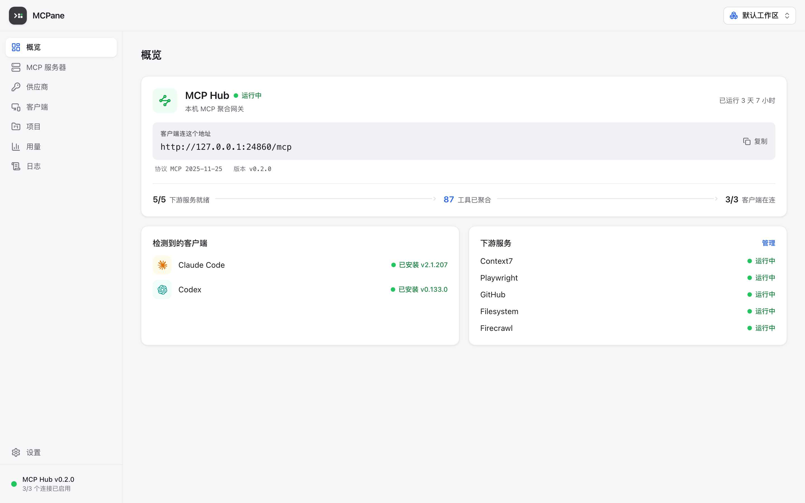
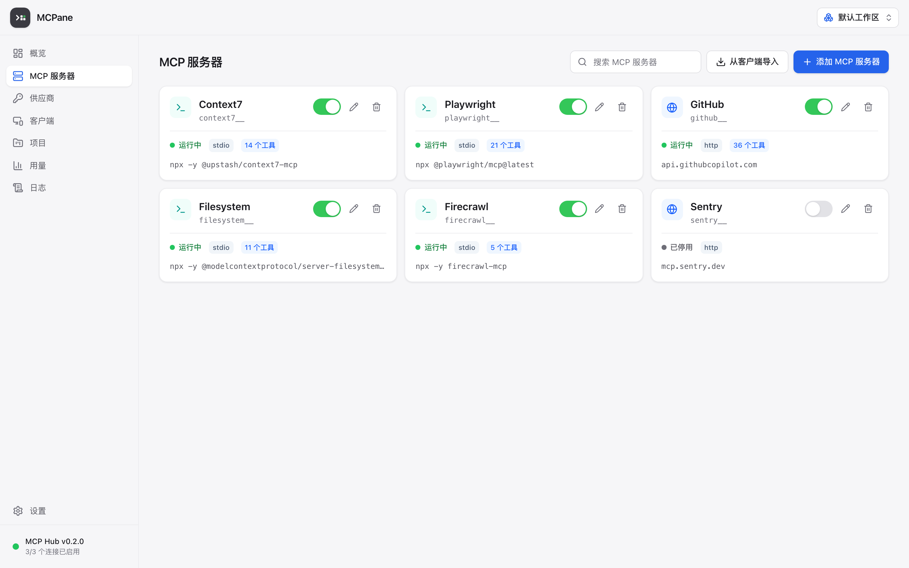

# MCPane

**Claude Code、Codex 与 MCP 生态的统一桌面控制面**

统一管理 MCP Server、AI 客户端接入与模型供应商配置——
Server 仅需配置一次，全部客户端即刻共用；每一次配置写入可预览、可回滚。

[下载安装](#下载安装) · [核心特性](#核心特性) · [更新日志][changelog] · [问题反馈][issues] · [安全策略][security]

[![Release][release-shield]][release-link]
[![Downloads][downloads-shield]][release-link]
[![Platform][platform-shield]][release-link]
[![Release Date][release-date-shield]][release-link]

> [!NOTE]
> 本仓库为 MCPane 的官方分发仓库，用于发布安装包与更新清单，不包含源代码。

## 核心特性

- **统一 MCP Hub**——各客户端共用同一本地聚合端点（`http://127.0.0.1:24860/mcp`），MCP Server 仅需配置一次；支持 stdio、Streamable HTTP、SSE 三种传输方式
- **多客户端接入**——一键接入 Claude Code、Claude Desktop、Codex、Gemini CLI、Grok、OpenCode、OpenClaw、Hermes 八款客户端；按各客户端原生配置格式读写，注释、未知字段与键序完整保留
- **供应商管理**——官方订阅与第三方中转分类管理、一键切换，支持配额查询与节点测速
- **精细化控制**——按项目 / 工作区逐项启停 Server 与工具，支持工具别名；提供工具动态发现模式，避免大规模工具集占用模型上下文
- **配置安全**——写入前自动快照、原子写入，任意一次变更可回滚；检测到外部改动时提醒，不静默覆盖
- **可观测性**——请求日志（已脱敏）、近 24 小时聚合统计与会话成本估算
- **数据管理**——本地自动备份，支持 WebDAV / S3 云同步
- **系统集成**——系统托盘常驻、开机自启，简体中文 / English 双语，浅色 / 深色主题

## 下载安装

前往 [Releases][release-link] 下载对应平台的安装包：

| 平台 | 安装包 | 系统要求 |
| --- | --- | --- |
| macOS（Apple Silicon） | `MCPane_x.y.z_aarch64.dmg` | macOS 12.0 及以上 |
| macOS（Intel） | `MCPane_x.y.z_x64.dmg` | macOS 12.0 及以上 |
| Windows（x64） | `MCPane_x.y.z_x64-setup.exe` | Windows 10 1803 及以上 |

> 如不确定 Mac 芯片类型：点击左上角苹果菜单 →「关于本机」，查看「芯片」一行。

### 首次运行

当前安装包尚未进行代码签名，首次打开会被操作系统拦截，按以下步骤放行一次即可；
后续版本升级由应用内自动更新完成，不会再次触发。

**macOS**（提示「无法验证开发者」）：

1. 双击打开一次（会被拦截），点击「完成」
2. 打开「系统设置 → 隐私与安全性」，页面底部会出现 MCPane 被阻止的提示
3. 点击「仍要打开」并确认

**Windows**（SmartScreen 提示「已保护你的电脑」）：

1. 点击提示中的「更多信息」
2. 点击「仍要运行」

### 自动更新

应用在启动时静默检查新版本，发现后以横幅提示并就地下载安装；
更新包均经签名校验。可在「设置」页关闭自动检查。

## 反馈与支持

- **缺陷报告与功能建议**：请通过 [Issues][issues] 提交，模板会引导填写必要信息
- **安全漏洞**：请勿公开披露，处理流程见[安全策略][security]
- **版本变更**：见[更新日志][changelog]与各版本 [Release][release-link] 说明

## Star History

如果 MCPane 对你有帮助，欢迎点一颗 Star——这也是我们了解关注度的主要途径。

在 [star-history.com](https://www.star-history.com/#yeuxuan/mcpane&Date) 查看本仓库的 Star 增长曲线。

<!-- Star History 图表：star-history 现要求仓库所有者用 GitHub token 在官网签发
     sealed_token 嵌入（GitHub 已限制 stargazers API 匿名访问）。
     签发后把 <picture> 嵌入代码贴回此处替换上面一行。 -->

---

© 2026 MCPane · 保留所有权利

[changelog]: ./CHANGELOG.md
[issues]: https://github.com/yeuxuan/mcpane/issues
[security]: ./SECURITY.md
[release-link]: https://github.com/yeuxuan/mcpane/releases/latest
[release-shield]: https://img.shields.io/github/v/release/yeuxuan/mcpane?style=flat-square&color=369eff
[downloads-shield]: https://img.shields.io/github/downloads/yeuxuan/mcpane/total?style=flat-square&color=45cc11
[platform-shield]: https://img.shields.io/badge/platform-macOS%20%7C%20Windows-8A2BE2?style=flat-square
[release-date-shield]: https://img.shields.io/github/release-date/yeuxuan/mcpane?style=flat-square&label=released
